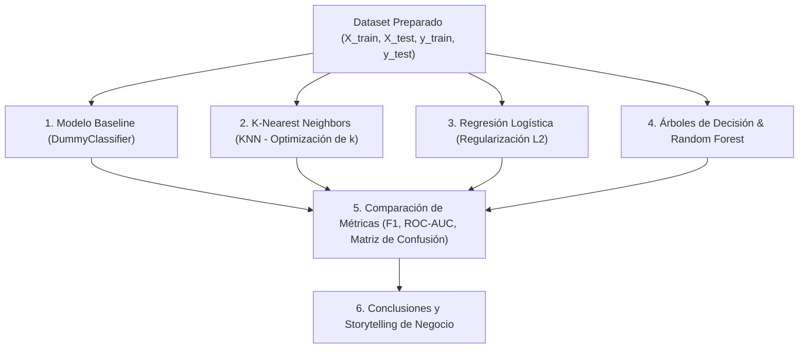

# 📄 Informe Ejecutivo de la Pre-Entrega — Machine Learning

**Programa:** Talento Tech — Especialización en Machine Learning (Nivel Avanzado)  
**Comisión:** #26240  
**Docente:** Maximiliano Torreblanca  
**Tutora:** Agustina Digiesi  
**Estudiante:** Matías Hernández  
**Fecha:** Octubre 2026  
**Cuaderno de Trabajo:** [`Pre_entrega26.ipynb`](Pre_entrega26.ipynb)  

---

## 1. Resumen Ejecutivo y Planteo del Problema

El presente trabajo constituye la **Pre-Entrega del Proyecto Integrador** del curso de Machine Learning. El objetivo central de esta etapa es construir un pipeline integral, reproducible y técnicamente fundamentado de preparación de datos orientado a resolver un problema real de la industria del entretenimiento y streaming musical: **la predicción de éxitos comerciales (*Hit Prediction*) a partir de propiedades de audio**.

### Definición del Problema de Machine Learning:
- **Paradigma:** Aprendizaje Supervisado — **Clasificación Binaria**.
- **Variable Objetivo (`target`):** `is_hit` $\in \{0, 1\}$.
  - $1$ (**Hit**): Pistas musicales con índice de popularidad superior a 50 (`popularity > 50`), representando el cuartil superior de impacto comercial.
  - $0$ (**No Hit / Nicho**): Canciones de desempeño estándar, menor visibilidad o de catálogo profundo.
- **Espacio de Características (`features`):** Propiedades perceptuales y sensoriales del sonido (bailabilidad, nivel de energía, volumen sonoro en dB, valencia emocional, acústica, velocidad BPM, etc.).

---

## 2. Origen y Justificación del Dataset

Se seleccionó el [Spotify Tracks Dataset](https://www.kaggle.com/datasets/maharshipandya/-spotify-tracks-dataset) disponible en Kaggle, compuesto por **~114.000 observaciones** y **21 atributos**.

### Criterios de Selección:
1. **Escala y Naturaleza Tabular:** Proporciona un volumen suficiente de datos para capturar relaciones complejas y evitar sobreajuste, manteniéndose ágil y eficiente para su procesamiento en Google Colab sin incurrir en limitaciones de memoria RAM.
2. **Atributos Continuos Estandarizados:** La mayoría de sus métricas de audio (`danceability`, `energy`, `valence`, `speechiness`) se encuentran acotadas en el intervalo $[0.0, 1.0]$, lo que permite evaluar el impacto del escalado y trabajar con algoritmos métricos basados en distancias como **K-Nearest Neighbors (KNN)** (visto en la Clase 8).
3. **Relevancia de Negocio:** Permite abordar una problemática concreta con impacto económico en sellos discográficos, curaduría algorítmica de playlists y estrategias de promoción artística.

---

## 3. Principales Hallazgos del Análisis Exploratorio de Datos (EDA)

1. **Estructura y Calidad Inicial:**
   - La presencia de valores faltantes fue estrictamente marginal ($< 0.005\%$), concentrada en columnas textuales (`track_name`, `artists`, `album_name`).
   - Se identificaron duplicados tanto a nivel de fila completa como a nivel de identificador único (`track_id`), originados por la inclusión de una misma pista en diferentes playlists o recopilatorios de géneros diversos.
   - Se detectaron anomalías físicas en los mínimos, como canciones con duración de $0$ milisegundos o tempo de $0$ BPM.

2. **Distribución de la Popularidad y Balance de Clases:**
   - El índice de popularidad de Spotify presenta una distribución bimodal: un pico pronunciado en $0$ (canciones de catálogo no reproducidas o sin métricas registradas) seguido de una distribución acampanada entre 20 y 75.
   - Con el umbral en `popularity > 50`, el balance de clases resultante es de **$\approx 21.5\%$ Hits vs $\approx 78.5\%$ No Hits**. Este desbalance moderado es altamente realista y adecuado para entrenar modelos de clasificación supervisada evaluando métricas como *Precision*, *Recall*, *F1-score* y *ROC-AUC*.

3. **Morfología de las Variables de Audio:**
   - `danceability` y `valence` muestran distribuciones simétricas normales centradas en torno a $0.55$.
   - `energy` y `loudness` exhiben marcada asimetría negativa hacia valores altos (volumen elevado y compresión dinámica, concordante con la "Loudness War" de la producción moderna).
   - `speechiness` y `acousticness` presentan pronunciada asimetría positiva hacia valores bajos, evidenciando el predominio de música grabada electrificada/urbana con balance vocal estándar.

4. **Correlaciones Clave e Interacción Multivariada:**
   - **Colinealidad positiva fuerte:** `energy` vs. `loudness` ($r \approx +0.76$).
   - **Colinealidad negativa fuerte:** `energy` vs. `acousticness` ($r \approx -0.73$).
   - **Asociación positiva:** `valence` correlaciona positivamente con `danceability` ($r \approx +0.47$).
   - **Baja correlación lineal directa con `popularity` ($|r| < 0.15$):** Demuestra que el éxito comercial no se explica mediante una relación lineal elemental con un solo atributo sensorial, justificando plenamente la necesidad de algoritmos de Machine Learning capaces de mapear fronteras de decisión no lineales en espacios multidimensionales.

---

## 4. Estrategia de Limpieza y Curación de Datos

| Etapa | Diagnóstico / Problema | Acción Implementada | Justificación Técnica |
| :--- | :--- | :--- | :--- |
| **Duplicados de Catálogo** | Pistas idénticas presentes en múltiples géneros. | `drop_duplicates(subset=['track_id'])` | Previene la contaminación cruzada y fuga de información entre Train y Test. |
| **Valores Nulos** | Menos de 5 registros sin metadatos de texto. | `dropna()` directo | Pérdida muestral nula; evita imputaciones sintéticas artificiales. |
| **Inconsistencias Temporales** | Canciones con duración $\le 0$ ms o tracks $> 15$ min. | Filtro de rango $[10.000\text{ ms}, 900.000\text{ ms}]$ | Elimina errores de registro y tracks experimentales o ruidos de fondo. |

**Resultado final:** Más de **89.000 observaciones depuradas** con más del $90\%$ de retención de información original y $0\%$ de valores nulos o duplicados.

---

## 5. Transformaciones, Selección y Prevención de Data Leakage

1. **Ingeniería de Características:**
   - Generación del vector objetivo binario: `is_hit = (popularity > 50).astype(int)`.
   - Binarización de la variable cualitativa `explicit` a valores numéricos enteros ($0$ y $1$).
2. **Descarte Fundamentado de Atributos:**
   - Se removieron los identificadores textuales de alta cardinalidad (`track_id`, `artists`, `album_name`, `track_name`) para evitar que los algoritmos memoricen artistas en lugar de aprender el perfil auditivo de las canciones.
   - Se excluyó la variable original continua `popularity` para prevenir fuga directa del target (*target leakage*).
   - Se omitió el *One-Hot Encoding* sobre los 114 géneros de `track_genre` para no generar una matriz dispersa y evitar la **maldición de la dimensionalidad**, protegiendo el cálculo de distancias euclidianas en algoritmos sensibles como KNN.
3. **Partición Estratificada Train / Test:**
   - Proporción $80\%$ entrenamiento y $20\%$ prueba (`test_size=0.20, random_state=42, stratify=y`), preservando exactamente la proporción de hits en ambos conjuntos.
4. **Escalado Metodológico sin Fuga de Datos:**
   - Se aplicó `StandardScaler` ($\mu = 0, \sigma = 1$).
   - **Regla de oro de ML respetada:** El escalador fue entrenado estrictamente sobre el conjunto de entrenamiento (`fit_transform(X_train)`), y posteriormente aplicado a prueba únicamente mediante transformación (`transform(X_test)`), sin filtrar información estadística del examen final al entrenamiento.

---

## 6. Próximos Pasos para la Entrega Final

Con el pipeline de datos 100% preparado y validado, la segunda etapa del curso se enfocará en:

1. **Modelo Baseline:** Establecer la línea de base con `DummyClassifier` (estrategia de clase más frecuente).
2. **Experimentación Multimodelo:**
   - **K-Nearest Neighbors (KNN):** Búsqueda sistemática del hiperparámetro $k$ óptimo ($k \in [3, 5, 11, 21]$) y ponderación de distancias (*uniform* vs. *distance*).
   - **Regresión Logística:** Ajuste lineal probabilístico con regularización.
   - **Árboles de Decisión y Random Forest:** Modelos basados en reglas para evaluar interacciones no lineales e importancia relativa de atributos (*feature importance*).
3. **Métricas de Evaluación:**
   - Matriz de confusión para ponderar costos de Falsos Positivos vs. Falsos Negativos.
   - *Precision*, *Recall*, *F1-score* ponderado y curva *ROC-AUC*.
4. **Optimización con Validación Cruzada:** Ajuste fino con `GridSearchCV` / `StratifiedKFold`.
