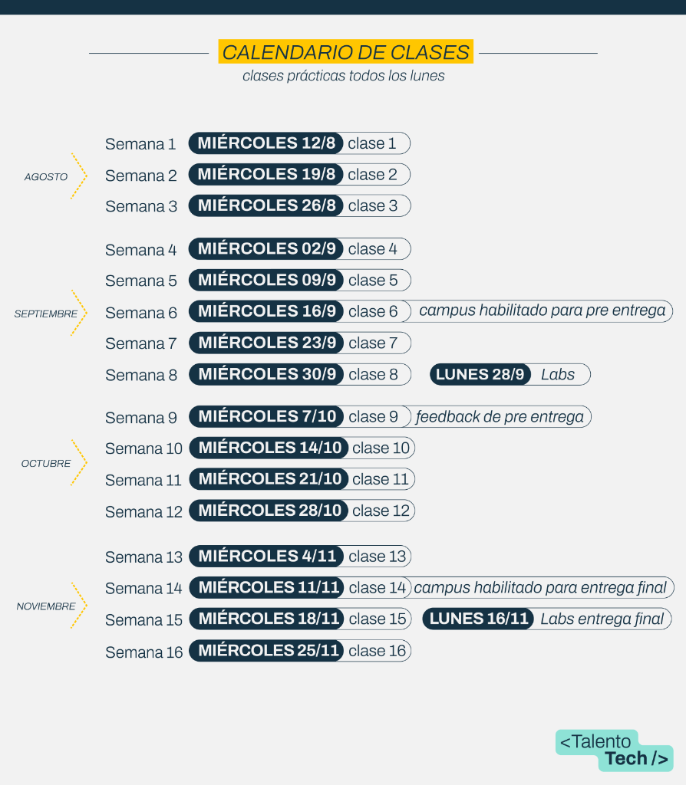

# 📅 Calendario y Cronograma Oficial - Talento Tech ML (Comisión #26240)

> **Datos de la Comisión:**
> - **Comisión:** #26240
> - **Instructor:** Maximiliano Torreblanca (`maximiliano.torreblanca@bue.edu.ar`)
> - **Tutora:** Agustina Digiesi (`agustina.digiesi@bue.edu.ar`)
> - **Clases en Vivo (Obligatorias):** Miércoles de 19:00 a 21:00 hs — Zoom ID: `837 0168 9705` (Ingreso con nombre y apellido completo).
> - **Clases Prácticas / Consultas:** Lunes de 19:00 a 20:00 hs.
> - **Régimen de Asistencia:** Máximo **3 inasistencias** en todo el cuatrimestre (justificadas o no). Superar este límite causa la baja del curso.

---

## 📌 Hitos Principales y Entregas

| Hito | Fecha | Semana | Detalle |
| :--- | :---: | :---: | :--- |
| **Inicio de Cursada (Clase 1)** | **Miércoles 12/08** | Semana 1 | Introducción, Python y herramientas |
| **Habilitación de Campus para Preentrega** | **Miércoles 16/09** | Semana 6 | Apertura en el campus para entrega de Preentrega |
| **Labs Preentrega** | **Lunes 28/09** | Semana 8 | Sesión práctica de soporte para Preentrega |
| **Feedback de Preentrega** | **Miércoles 07/10** | Semana 9 | Devolución docente sobre el proyecto entregado |
| **Habilitación de Campus para Entrega Final** | **Miércoles 11/11** | Semana 14 | Apertura en el campus para el Proyecto Integrador Final |
| **Labs Entrega Final** | **Lunes 16/11** | Semana 15 | Sesión práctica de soporte para Entrega Final |
| **Cierre de Cursada (Clase 16)** | **Miércoles 25/11** | Semana 16 | Cierre formal y finalización del curso |

---

## 🗓️ Cronograma Detallado y Materiales en Drive

### ☀️ Agosto
| Semana | Fecha | Tipo | Tema / Actividad | Material en Drive |
| :---: | :---: | :---: | :--- | :--- |
| **Semana 1** | Mié 12/08 | **Clase 1** | Introducción a Machine Learning y entorno | `ML - CLASE 01.md`, `ML CLASE _ 01.pdf` |
| **Semana 1** | Lun 17/08 | Práctica | Primera clase práctica / consultas | `ML - CLASE 01 - Ejercicios.pdf` |
| **Semana 2** | Mié 19/08 | **Clase 2** | Análisis Exploratorio de Datos (EDA) y Pandas | `ML - CLASE 02.md`, `ML - CLASE 02.pdf` |
| **Semana 2** | Lun 24/08 | Práctica | Ejercicios de EDA y manipulación | `ML - CLASE 02 - Ejercicios.pdf` |
| **Semana 3** | Mié 26/08 | **Clase 3** | Preprocesamiento y Feature Engineering | `ML - CLASE 03.md`, `ML CLASE _ 03.pdf` |
| **Semana 3** | Lun 31/08 | Práctica | Ejercicios de transformación de datos | `ML - CLASE 03 - Ejercicios.pdf` |

---

### 🍂 Septiembre (Mes de la Preentrega)
| Semana | Fecha | Tipo | Tema / Actividad | Material en Drive |
| :---: | :---: | :---: | :--- | :--- |
| **Semana 4** | Mié 02/09 | **Clase 4** | Modelos de Regresión Lineal y métricas | `ML - CLASE 04.md`, `Copia de clase4_2026b.ipynb` |
| **Semana 4** | Lun 07/09 | Práctica | Ejercicios de Regresión | `ML - CLASE 04 - Ejercicios.pdf` |
| **Semana 5** | Mié 09/09 | **Clase 5** | Regresión Logística y Clasificación | `ML - CLASE 05.md`, `Clase_5.ipynb` |
| **Semana 5** | Lun 14/09 | Práctica | Práctica de matrices de confusión y métricas | `ML - CLASE 05 - Ejercicios.pdf` |
| **Semana 6** | Mié 16/09 | **Clase 6** | 🚀 **Campus habilitado para preentrega** - Árboles de Decisión | `ML - CLASE 06.md`, `Clase_6.ipynb` |
| **Semana 6** | Lun 21/09 | Práctica | Práctica de Árboles y dudas preentrega | `ML - CLASE 06 - Ejercicios.pdf` |
| **Semana 7** | Mié 23/09 | **Clase 7** | Métodos de ensamble (Random Forest, Boosting) | `Copia de (Alumnos)Clase_7.ipynb` |
| **Semana 7** | Lun 28/09 | **Labs** | 🧪 **Labs Preentrega** (Consultas intensivas de entrega) | `Pre_entrega26.ipynb` |
| **Semana 8** | Mié 30/09 | **Clase 8** | Consolidación y evaluación de modelos | `Clase_8.ipynb` |

---

### 🍁 Octubre
| Semana | Fecha | Tipo | Tema / Actividad |
| :---: | :---: | :---: | :--- |
| **Semana 9** | Mié 07/10 | **Clase 9** | 🎯 **Feedback de preentrega** y optimización de hiperparámetros |
| **Semana 10** | Mié 14/10 | **Clase 10** | Aprendizaje No Supervisado (Clustering, K-Means, PCA) |
| **Semana 11** | Mié 21/10 | **Clase 11** | Pipelines avanzados y reducción de dimensionalidad |
| **Semana 12** | Mié 28/10 | **Clase 12** | Modelos avanzados y preparación hacia la entrega final |

---

### ❄️ Noviembre (Mes de la Entrega Final)
| Semana | Fecha | Tipo | Tema / Actividad |
| :---: | :---: | :---: | :--- |
| **Semana 13** | Mié 04/11 | **Clase 13** | Afinamiento de modelos y diagnóstico de overfitting |
| **Semana 14** | Mié 11/11 | **Clase 14** | 🏆 **Campus habilitado para entrega final** |
| **Semana 15** | Lun 16/11 | **Labs** | 🧪 **Labs entrega final** (Revisión técnica de código y métricas) |
| **Semana 15** | Mié 18/11 | **Clase 15** | Storytelling, conclusiones de negocio y preparación de pitch |
| **Semana 16** | Mié 25/11 | **Clase 16** | 🎉 **Cierre de cursada y defensas** |
