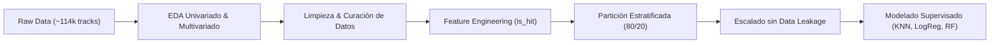

# 🎵 Spotify Hit Predictor & Machine Learning Portfolio

[](https://www.python.org/)
[](https://scikit-learn.org/)
[](https://pandas.pydata.org/)
[](https://numpy.org/)
[](https://colab.research.google.com/drive/1Zff5mrXXnKZtKsUyN2mEs869GO3ItfZX)
[](https://opensource.org/licenses/MIT)

> **Proyecto Integrador de Machine Learning** — Especialización Avanzada en Inteligencia Artificial y Ciencia de Datos (**Talento Tech** | Comisión #26240).  
> **Estudiante:** Matías Hernández ([@tutecoach](https://github.com/tutecoach))  
> **Docente:** Maximiliano Torreblanca | **Tutora:** Agustina Digiesi  

---

## 📌 Resumen del Proyecto

Este repositorio documenta el desarrollo integral del **Proyecto Integrador de Machine Learning**, estructurado en dos grandes hitos formativos: la **Preentrega** (auditoría, curación, EDA y preparación de pipeline) y la **Entrega Final** (experimentación multimodelo supervisado y optimización).

El problema de estudio aborda una necesidad crítica en la industria global de streaming de audio: **predecir si una pista musical posee el perfil acústico para convertirse en un éxito comercial (*Hit Prediction*)**, utilizando atributos psicoacústicos cuantificados por la API de Spotify.



---

## 🎯 Definición del Problema de Machine Learning

- **Tipo de Tarea:** Aprendizaje Supervisado — **Clasificación Binaria**.
- **Dataset:** [Spotify Tracks Dataset](https://www.kaggle.com/datasets/maharshipandya/-spotify-tracks-dataset) recopilado por Maharshi Pandya vía Spotify Web API (~114.000 observaciones, 21 columnas).
- **Target (`is_hit`):** 
  - `1` (**Hit**): Pista con índice de popularidad superior a 50 (`popularity > 50`), representando el cuartil superior de impacto comercial ($\approx 21.5\%$).
  - `0` (**No Hit / Nicho**): Canción de catálogo estándar o nicho ($\approx 78.5\%$).
- **Espacio de Características ($X$):** Atributos perceptuales objetivos: `danceability`, `energy`, `loudness`, `speechiness`, `acousticness`, `instrumentalness`, `liveness`, `valence`, `tempo`, `explicit`, `mode`, `key`, `duration_ms`, `time_signature`.

---

## 🔬 Metodología y Buenas Prácticas Aplicadas

### 1. Análisis Exploratorio de Datos (EDA)
- **Diagnóstico Estructural:** Evaluación de tipos de datos, cardinalidades y valores nulos ($< 0.005\%$).
- **Distribución de Popularidad:** Identificación de bimodalidad (concentración inicial en 0 correspondiente a catálogo pasivo, seguida de distribución acampanada).
- **Matriz de Correlación de Pearson Anotada:**
  - Fuerte correlación positiva entre `energy` y `loudness` ($r \approx +0.76$).
  - Fuerte correlación negativa entre `energy` y `acousticness` ($r \approx -0.73$).
  - Baja correlación lineal individual entre atributos aislados y popularidad ($|r| < 0.15$), evidenciando que el éxito depende de **interacciones no lineales complejas** y justificando la adopción de algoritmos de Machine Learning.

### 2. Curación y Limpieza de Datos
- **Desduplicación Lógica por `track_id`:** Eliminación de redundancias causadas por la aparición de una misma pista en múltiples recopilatorios o playlists de género, erradicando el riesgo de contaminación cruzada.
- **Filtrado de Inconsistencias Físicas:** Eliminación de canciones con duración $0$ ms o anomalías temporales ($10\text{ s} \le \text{duración} \le 15\text{ min}$), reteniendo más del $90\%$ de los datos válidos.

### 3. Prevención de Fuga de Información (*Zero Data Leakage*)
- **Regla de oro respetada:** La separación en subconjuntos de entrenamiento y prueba se ejecutó **antes** de cualquier procedimiento de escalado o normalización.
- Partición estratificada 80/20 (`stratify=y`) para conservar la tasa de hits en ambos conjuntos.
- El escalador (`StandardScaler`) fue entrenado estrictamente sobre `X_train` (`fit_transform`) y proyectado sobre `X_test` (`transform`), garantizando la pureza matemática de la evaluación.

---

## 📂 Estructura del Repositorio

```text
├── 01_clases/                          # Bitácora teórica de Clases 01 a 08 (Markdown)
│   ├── ML - CLASE 01.md a 08.md
│   └── README.md
├── 02_proyectos/
│   ├── preentrega/                     # 🚀 Hito 1: Pre-Entrega de Proyecto
│   │   ├── Pre_entrega26.ipynb         # Cuaderno Jupyter oficial (24 celdas documentadas)
│   │   ├── informe_preentrega.md       # Memoria técnica ejecutiva
│   │   ├── ML_Consigna_Pre-entrega.md  # Rúbrica y consigna oficial
│   │   └── README.md
│   └── proyecto_final/                 # 🏆 Hito 2: Entrega Final (en desarrollo)
│       └── README.md
├── 03_recursos/                        # Cronogramas y base de conocimiento
│   ├── cronograma/
│   └── BASE_CONOCIMIENTO.md
├── 04_colab_sync/                      # Scripts de sincronización con Google Drive
├── CALENDARIO_CURSADA.md               # Calendario oficial de cursada y entregas
├── PROYECTO_INTEGRADOR.md              # Checklist metodológico y rúbricas
└── README.md                           # Portada y documentación de portfolio
```

---

## 🚀 Hoja de Ruta para la Entrega Final

Con el pipeline de preprocesamiento consolidado, la segunda etapa abordará:

1. **Modelo Baseline:** `DummyClassifier` con estrategia de clase mayoritaria.
2. **Modelado Comparativo Supervisado:**
   - **K-Nearest Neighbors (KNN):** Optimización de hiperparámetro $k$ y ponderación por distancia euclidiana (Clase 8).
   - **Regresión Logística:** Clasificación probabilística con regularización L2.
   - **Árboles de Decisión y Random Forest:** Modelos de ensamble para medir la importancia relativa de variables (*Feature Importance*).
3. **Métricas de Rendimiento:** *Precision*, *Recall*, *F1-score*, matriz de confusión y curvas *ROC-AUC*.
4. **Storytelling de Negocio:** Conclusiones estratégicas aplicables a la producción y curaduría musical basada en datos.

---

## 💻 Cómo Ejecutar este Proyecto

### Opción 1: En la Nube (Recomendado)
Haz clic en el siguiente botón para abrir el cuaderno directamente en **Google Colab**:  
[](https://colab.research.google.com/drive/1Zff5mrXXnKZtKsUyN2mEs869GO3ItfZX)

### Opción 2: Localmente
```bash
# 1. Clonar el repositorio
git clone https://github.com/tutecoach/talento-tech-ml.git
cd talento-tech-ml

# 2. Crear y activar entorno virtual
python -m venv venv
source venv/bin/activate  # En Windows: venv\Scripts\activate

# 3. Instalar dependencias requeridas
pip install pandas numpy scikit-learn matplotlib seaborn kagglehub jupyter

# 4. Iniciar Jupyter Notebook
jupyter notebook 02_proyectos/preentrega/Pre_entrega26.ipynb
```

---

## 👤 Autor

**Matías Hernández**  
- **GitHub:** [@tutecoach](https://github.com/tutecoach)  
- **Email:** `matias.h.a.hernandez@gmail.com`  
- **Programa:** Talento Tech — Machine Learning (Comisión #26240)
