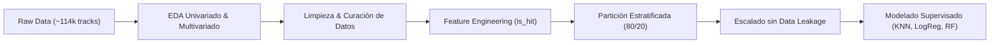
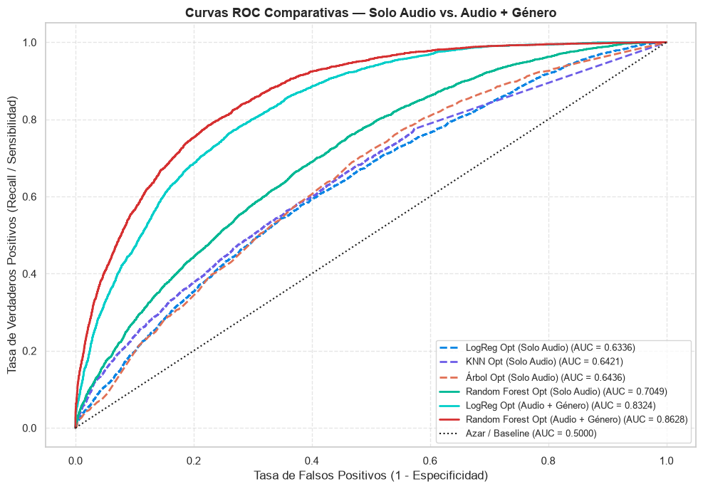
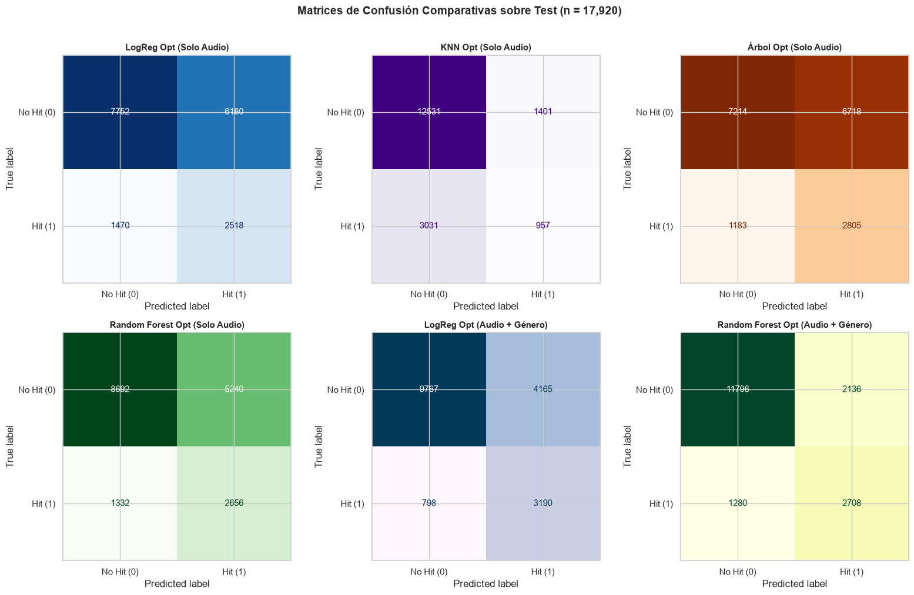
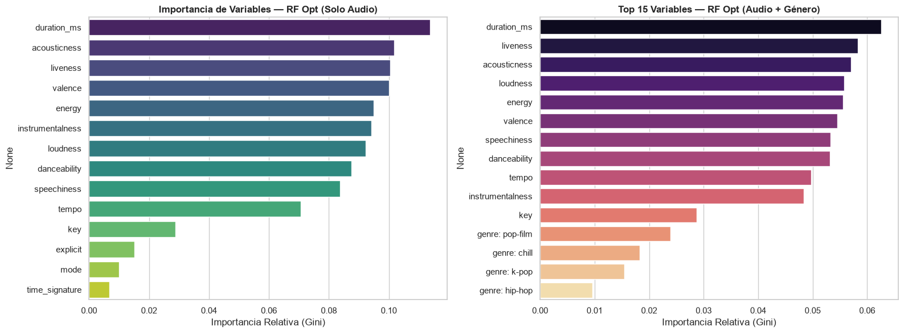
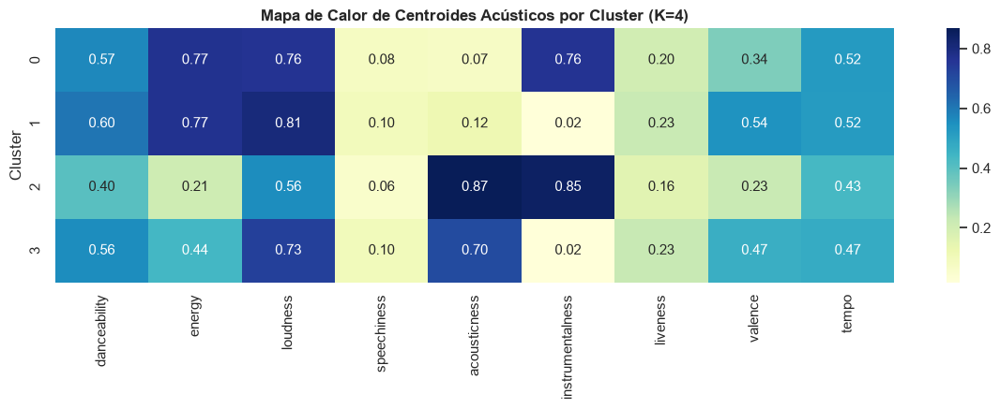

# 🎵 Spotify Hit Predictor & Machine Learning Portfolio

[](https://www.python.org/)
[](https://scikit-learn.org/)
[](https://pandas.pydata.org/)
[](https://numpy.org/)
[](https://colab.research.google.com/drive/1Xuc2NMKoCCsg2QH1H7RNSqadfTVYN0HF)
[](https://opensource.org/licenses/MIT)

> **Proyecto Integrador de Machine Learning** — Especialización Avanzada en Inteligencia Artificial y Ciencia de Datos (**Talento Tech** | Comisión #26240).  
> **Estudiante:** Matías Hernández ([@tutecoach](https://github.com/tutecoach))  
> **Docente:** Maximiliano Torreblanca | **Tutora:** Agustina Digiesi  

---

## 📌 Resumen del Proyecto

Este repositorio documenta el desarrollo integral del **Proyecto Integrador de Machine Learning**, estructurado en dos grandes hitos formativos: la **Preentrega** (auditoría, curación, EDA y preparación de pipeline) y la **Entrega Final** (experimentación multimodelo supervisado y optimización).

El problema de estudio aborda una necesidad crítica en la industria global de streaming de audio: **predecir si una pista musical posee el perfil acústico para convertirse en un éxito comercial (*Hit Prediction*)**, utilizando atributos psicoacústicos cuantificados por la API de Spotify.



---

## 🎯 Definición del Problema de Machine Learning

- **Tipo de Tarea:** Aprendizaje Supervisado — **Clasificación Binaria**.
- **Dataset:** [Spotify Tracks Dataset](https://www.kaggle.com/datasets/maharshipandya/-spotify-tracks-dataset) recopilado por Maharshi Pandya vía Spotify Web API (~114.000 observaciones, 21 columnas).
- **Target (`is_hit`):** 
  - `1` (**Hit**): Pista con índice de popularidad superior a 50 (`popularity > 50`), representando el segmento de mayor impacto comercial (**22,25%** del dataset depurado).
  - `0` (**No Hit / Nicho**): Canción de catálogo estándar o nicho (**77,75%**).
- **Espacio de Características ($X$):** Atributos perceptuales objetivos (*Solo Audio*, 14 variables): `danceability`, `energy`, `loudness`, `speechiness`, `acousticness`, `instrumentalness`, `liveness`, `valence`, `tempo`, `explicit`, `mode`, `key`, `duration_ms`, `time_signature`, ampliado en la iteración final con `track_genre` vía `ColumnTransformer` + `OneHotEncoder`.

---

## 🔬 Metodología y Buenas Prácticas Aplicadas

### 1. Análisis Exploratorio de Datos (EDA)
- **Diagnóstico Estructural:** Evaluación de tipos de datos, cardinalidades y valores nulos ($< 0.005\%$).
- **Distribución de Popularidad:** Identificación de bimodalidad (concentración inicial en 0 correspondiente a catálogo pasivo, seguida de distribución acampanada).
- **Matriz de Correlación de Pearson Anotada:**
  - Fuerte correlación positiva entre `energy` y `loudness` ($r \approx +0.76$).
  - Fuerte correlación negativa entre `energy` y `acousticness` ($r \approx -0.73$).
  - Baja correlación lineal individual entre atributos aislados y popularidad ($|r| < 0.15$), evidenciando que el éxito depende de **interacciones no lineales complejas** y justificando la adopción de algoritmos de Machine Learning.

### 2. Curación y Limpieza de Datos
- **Desduplicación Lógica por `track_id`:** Eliminación de **24.259** registros redundantes causados por la aparición de una misma pista en múltiples recopilatorios o playlists de género, erradicando el riesgo de contaminación cruzada.
- **Filtrado de Inconsistencias y Prevención de *Index Leakage*:** Eliminación de 3 filas con nulos marginales y 142 anomalías de duración ($< 10\text{ s}$ o $> 15\text{ min}$), consolidando **89.598 pistas únicas** (**78,59%** de retención). Además, se descartó explícitamente la columna índice `Unnamed: 0` (ordenada por género en el CSV) para impedir fuga por ordenamiento.

### 3. Prevención de Fuga de Información (*Zero Data Leakage*)
- **Regla de oro respetada:** La separación en subconjuntos de entrenamiento y prueba se ejecutó **antes** de cualquier procedimiento de escalado o normalización.
- Partición estratificada 80/20 (`stratify=y`) para conservar la tasa de hits en ambos conjuntos.
- El escalador (`StandardScaler`) fue entrenado estrictamente sobre `X_train` (`fit_transform`) y proyectado sobre `X_test` (`transform`), garantizando la pureza matemática de la evaluación.

---

## 📂 Estructura del Repositorio

```text
├── 01_clases/                          # Bitácora teórica, ejercicios y Colabs (Clases 01 a 16)
│   ├── ML - CLASE 01.md a 08.md, 10.md a 16.md
│   ├── ML CLASE _ 10.pdf a 16.pdf      # Respaldos PDF locales (gitignored)
│   ├── ejercicios/                     # Guías prácticas (Clases 07–08, 10–15 y K-Means)
│   ├── colabs/                         # Cuadernos .ipynb de clase (Clase 09)
│   └── README.md
├── 02_proyectos/
│   ├── preentrega/                     # 🚀 Hito 1: Pre-Entrega de Proyecto
│   │   ├── Pre_entrega26.ipynb         # Cuaderno Jupyter oficial (24 celdas documentadas)
│   │   ├── informe_preentrega.md       # Memoria técnica ejecutiva
│   │   ├── ML_Consigna_Pre-entrega.md  # Rúbrica y consigna oficial
│   │   └── README.md
│   └── proyecto_final/                 # 🏆 Hito 2: Entrega Final (completada)
│       ├── Pre_entrega26.ipynb         # Cuaderno continuado (47 celdas ejecutadas, B1–B7 + K-Means)
│       ├── informe_final.md            # Memoria técnica y ejecutiva final
│       ├── ML_Consigna_Entrega_Final.md
│       ├── CHECKLIST_ENTREGA_FINAL.md
│       ├── ML - Checklist Entrega Final.docx
│       ├── ML_Referencia_Docente_Pre_entrega26.ipynb
│       └── README.md
├── 03_recursos/                        # Cronogramas y base de conocimiento
│   ├── cronograma/
│   └── BASE_CONOCIMIENTO.md
├── 04_colab_sync/                      # Scripts de sincronización con Google Drive
├── assets/                             # Gráficos exportados de resultados para portafolio
│   ├── curvas_roc_auc.png
│   ├── feature_importance.png
│   ├── kmeans_clusters_heatmap.png
│   └── matrices_confusion.png
├── CALENDARIO_CURSADA.md               # Calendario oficial de cursada y entregas
├── PROYECTO_INTEGRADOR.md              # Checklist metodológico y rúbricas
└── README.md                           # Portada y documentación de portfolio
```

---

## 🏆 Resultados de la Entrega Final

Continuando sobre el mismo cuaderno de Pre-Entrega (`89,598` pistas únicas; `71,678` Train / `17,920` Test; `22.25%` Hits y corrección de `'Unnamed: 0'` para evitar *index leakage*), se compararon modelos base, optimizados con `GridSearchCV` + `Pipeline` y enriquecidos con `track_genre` mediante `ColumnTransformer`:

| Modelo Evaluado | F1 CV (5-Fold) | ROC-AUC CV (5-Fold) | Accuracy Test | F1-Score (Hit) | ROC-AUC Test |
| :--- | :---: | :---: | :---: | :---: | :---: |
| `0. Baseline (Dummy Most Frequent)` | `0.0000 ± 0.0000` | `0.5000 ± 0.0000` | `0.7775` | `0.0000` | `0.5000` |
| `1b. Regresión Logística (Opt - Solo Audio)` | `0.3927 ± 0.0051` | `0.6280 ± 0.0045` | `0.5731` | `0.3970` | `0.6336` |
| `2b. KNN (Opt - Solo Audio)` | `0.2819 ± 0.0077` | `0.6347 ± 0.0050` | `0.7527` | `0.3016` | `0.6421` |
| `3b. Árbol de Decisión (Opt - Solo Audio)` | `0.4120 ± 0.0029` | `0.6414 ± 0.0021` | `0.5591` | `0.4152` | `0.6436` |
| `4b. Random Forest (Opt - Solo Audio)` | `0.4441 ± 0.0025` | `0.7005 ± 0.0028` | `0.6333` | `0.4470` | `0.7049` |
| `5. Regresión Logística (Opt - Audio+Género)` | `0.5642 ± 0.0060` | `0.8316 ± 0.0042` | `0.7230` | `0.5625` | `0.8324` |
| **`6. Random Forest (Opt - Audio+Género)`** 🏆 | **`0.6106 ± 0.0040`** | **`0.8597 ± 0.0014`** | **`0.8094`** | **`0.6132`** | **`0.8628`** |

- **Bonus Clustering No Supervisado (`K-Means`, `k = 4`, Silhouette = `0.3175`):** el *Cluster 1* (*Mainstream Pop, Dance & Urbano Comercial*) concentra un **`25.61%` de Hits**, más del doble que el *Cluster 0* instrumental energético (`11.99%`).
- Ver memoria completa en [`02_proyectos/proyecto_final/informe_final.md`](02_proyectos/proyecto_final/informe_final.md).

### 📊 Visualizaciones Clave

#### Curvas ROC-AUC Comparativas (*Solo Audio vs. Audio + Género*)


#### Matrices de Confusión Comparativas sobre Test (`n = 17,920`)


#### Importancia Relativa de Variables (*Random Forest Optimizado*)


#### Perfil Acústico Promedio por Cluster (`K-Means`, `k = 4`)


---

## 💻 Cómo Ejecutar este Proyecto

### Opción 1: En la Nube (Google Colab)
- **Entrega Final (Completo — Parte A + Parte B):** [](https://colab.research.google.com/drive/1Xuc2NMKoCCsg2QH1H7RNSqadfTVYN0HF)
- **Pre-Entrega Original (Hito 1 archivado):** [](https://colab.research.google.com/drive/1Zff5mrXXnKZtKsUyN2mEs869GO3ItfZX)

### Opción 2: Localmente
```bash
# 1. Clonar el repositorio
git clone https://github.com/tutecoach/talento-tech-ml.git
cd talento-tech-ml

# 2. Crear y activar entorno virtual
python -m venv venv
source venv/bin/activate  # En Windows: venv\Scripts\activate

# 3. Instalar dependencias requeridas
pip install pandas numpy scikit-learn matplotlib seaborn kagglehub jupyter

# 4. Iniciar Jupyter Notebook
jupyter notebook 02_proyectos/proyecto_final/Pre_entrega26.ipynb
```

---

## 👤 Autor

**Matías Hernández**  
- **GitHub:** [@tutecoach](https://github.com/tutecoach)  
- **Email:** `matias.h.a.hernandez@gmail.com`  
- **Programa:** Talento Tech — Machine Learning (Comisión #26240)
